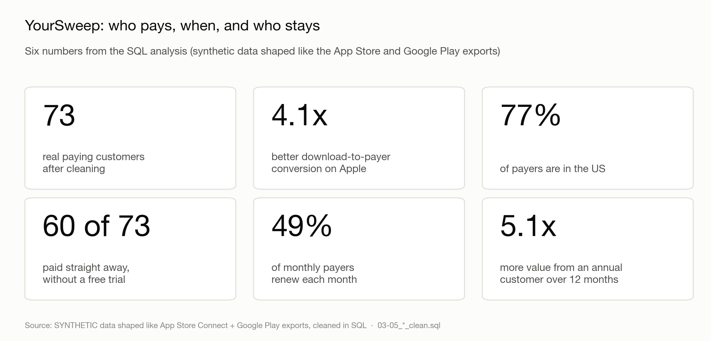

# YourSweep: why travellers pay, when, and who goes annual (SQL)

> **All data in this repo is synthetic.** It was generated by
> `make_synthetic_data.py` to have the same columns and similar *patterns* as
> the real App Store Connect and Google Play exports of YourSweep, but no real
> customers, IDs, transactions or figures. Volumes are about 3x the real ones.
> The analysis was first done on the real (private) data with permission from
> YoursGlobal; this public version reruns the same SQL on the synthetic copy.

YourSweep is a travel safety app by YoursGlobal (7-day free trial, then
$8.99/month or $89.99/year). I used SQL to answer four questions:

1. **What turns someone into a payer?**
2. **When do they pay?**
3. **Why and when do they drop off?**
4. **Who goes annual?**



## Key findings (on the synthetic data)
- **Apple converts downloads to payers about 4x better than Google Play**, and
  most payers pay straight away rather than after a free trial (60 of 73).
- **Paying users are mostly in the US**: about a quarter of downloads, three
  quarters of payers. Big download countries like India and Brazil have none.
- **New payers come in bursts**: after a launch or a free-trial offer.
- **About half of monthly payers renew each month**, and Apple users who
  cancel almost always switch off auto-renew on day 0.
- **Annual is chosen at the start or never**: nobody switched plan. Over 12
  months an annual customer is worth about 5x a monthly one.

## How to run
```bash
python3 make_synthetic_data.py         # writes data/*.csv (fixed seed)
cd sql
python3 build_db.py                    # loads the CSVs into yoursweep.db (SQLite)
sqlite3 yoursweep.db < 02_cleaning_clean.sql   # clean views (run after every build)
sqlite3 -header -column yoursweep.db < 03_who_pays_and_when_clean.sql
cd .. && python3 python/portfolio_charts.py    # redraws figures/ (needs pandas, matplotlib)
```

## Files
| Step | File | What it does |
|---|---|---|
| Data | `make_synthetic_data.py`, `data/` | synthetic CSVs, same shape as the real exports |
| Load | `sql/build_db.py` | CSVs -> SQLite tables with types |
| EDA | `sql/01_eda_clean.sql` | size, date ranges, values, missing data, duplicates |
| Cleaning | `sql/02_cleaning_clean.sql` | rule-based cleaning, clean views |
| Q1, Q2 | `sql/03_who_pays_and_when_clean.sql` | funnel and timing of first payment |
| Q3 | `sql/04_drop_off_clean.sql` | trial drop-off, cancels, renewals, uninstalls |
| Q4 | `sql/05_annual_clean.sql` | annual vs monthly payers and value |
| Charts | `python/portfolio_charts.py` | every chart number comes from a SQL query |

## Tables
| Table | One row is |
|---|---|
| `payments` | one payment or refund |
| `subscription_events` | trial start, conversion, renewal, cancel, refund (daily counts on Play) |
| `active_subscriptions` | active subs per day, plan, offer and country |
| `downloads` | downloads/uninstalls per day and country |
| `reviews` | one store review (made-up wording) |
| `customers` (view) | one paying customer, built from `payments` |

## Cleaning decisions
| Problem | Decision |
|---|---|
| Refunded payers, or paid and cancelled the same day | not counted as payers (`count_as_payer = 0`) |
| Many currencies | compare with the `*_usd_approx` columns |
| Apple data starts later than Play | store comparisons start on the later start date (computed, not typed) |
| Old Play annual price ($49.99) | flagged as 'unusual', kept |

## Limitations
- Store exports have no user id on events, so trials and cancels are matched
  to payers by store + date + country + plan.
- Google Play doesn't report renewals, trial conversions or cancel timing as
  events, and Apple doesn't report uninstalls.
- No cancellation reasons beyond "Canceled".

## SQL used
GROUP BY, CASE, JOINs (incl. self-join), CTEs, recursive CTEs, window
functions, date functions, views, indexes, correlated subqueries.
